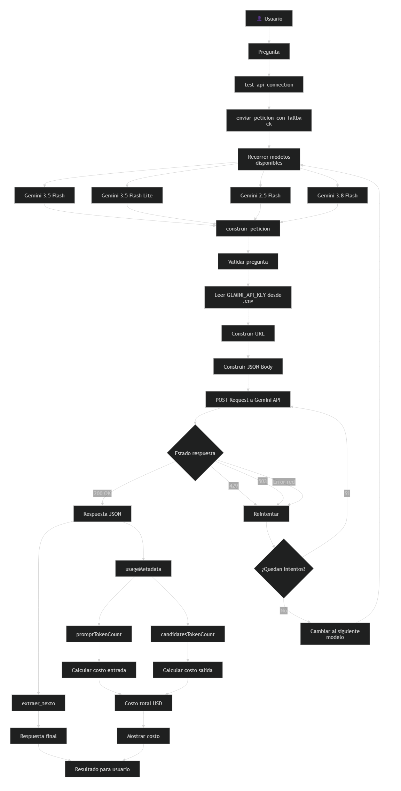

# Decisión de arquitectura: elección de modelo

## Modelo elegido

**Gemini-3.5-Flash-Lite**

Se seleccionó Gemini-3.5-Flash-Lite como modelo principal para la miniaplicación debido a su balance entre costo, velocidad de respuesta y calidad suficiente para las tareas requeridas.

## Diagrama de arquitectura

## Comparación de candidatos

| Criterio | Gemini-3.5-Flash | Gemini-3.5-Flash-Lite |
|-----------|-----------------|----------------------|
| Costo por 1000 tokens de entrada | $0.0000375 USD | $0.0000187 USD |
| Costo por 1000 tokens de salida | $0.0001875 USD | $0.0000937 USD |
| Latencia promedio observada | 3.93 segundos | 3.04 segundos |
| Calidad de respuesta | Alta precisión y riqueza de contexto | Respuestas directas y fluidas para tareas ágiles |
| Resultado | No seleccionado | Seleccionado |

## Justificación

El criterio más importante para esta miniaplicación fue la combinación entre costo y velocidad de respuesta. Gemini-3.5-Flash-Lite tiene un costo aproximadamente 50% menor tanto para tokens de entrada como de salida, además de presentar una latencia promedio inferior (3.04 segundos frente a 3.93 segundos).

Aunque Gemini-3.5-Flash ofrece respuestas más ricas en contexto, la miniaplicación no requiere razonamiento complejo ni generación de contenido altamente elaborado. Por este motivo, Gemini-3.5-Flash-Lite proporciona la mejor relación costo-beneficio manteniendo una calidad adecuada para el caso de uso.

## Alternativa descartada y por qué

**Modelo descartado:** Gemini-3.5-Flash

Gemini-3.5-Flash fue descartado porque presenta un costo significativamente superior y una latencia más alta respecto a Gemini-3.5-Flash-Lite. Aunque ofrece respuestas con mayor riqueza contextual, esa ventaja no compensa el aumento de costo para los requisitos específicos de esta miniaplicación.

Por tanto, Gemini-3.5-Flash-Lite resulta una opción más eficiente y sostenible desde el punto de vista económico y operativo.