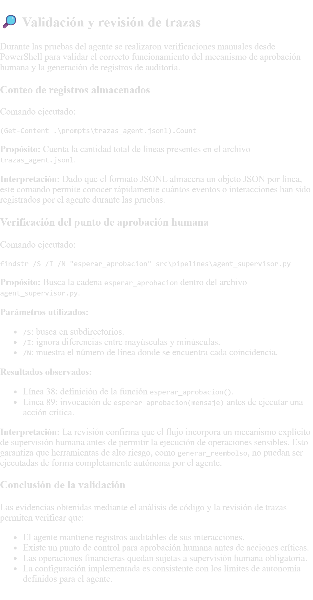

# Ficha de Diseño Funcional

## 1. Problema de negocio
Los ejecutivos comerciales y analistas de riesgo de una institución financiera ficticia (banca empresas) evalúan aproximadamente 100 solicitudes anuales (estimación) de renovación de líneas de crédito, capital de trabajo y factoring revisando manualmente estados financieros, carpetas tributarias y reportes comerciales, calculando indicadores en hojas de cálculo y redactando informes de riesgo desde cero. Actualmente, el proceso completo tarda entre 17 y 25 días hábiles por solicitud (estimación: 5 a 10 días en recolección documental, 5 días en preparación de propuesta y cálculo manual, y 7 a 10 días en revisión de riesgo), lo que genera una tasa de deserción estimada de entre 20 % y 25 % de operaciones válidas (unos 20 a 25 créditos perdidos al año, equivalentes a ~$10.000 MM–$12.500 MM CLP sin colocar y ~$600 MM–$800 MM CLP anuales en ingresos financieros no capturados, estimación). Se espera que cualquier ejecutivo o analista pueda consolidar los antecedentes de una solicitud simulada, obtener el cálculo estandarizado de ratios financieros con sus alertas de política y generar un borrador trazable del informe de riesgo en menos de 10 minutos por caso, reduciendo el ciclo operativo total a un rango de 2 a 3 días hábiles y disminuyendo la pérdida de operaciones por demora.

## 2. Requerimientos y alcance (MVP)

### Requerimientos funcionales
- RF-01: El usuario envía una solicitud de evaluación crediticia simulada (datos de empresa ficticia, montos y antecedentes financieros en JSON o texto estructurado) a un endpoint de consulta y recibe una respuesta estructurada con indicadores y dictamen sugerido.
- RF-02: El sistema calcula los ratios financieros clave (liquidez corriente, endeudamiento P/Pat, deuda financiera/EBITDA y DSCR) y asigna un semáforo de política (VERDE, AMARILLO o ROJO) según las reglas internas vigentes.
- RF-03: Cada evaluación recupera y cita explícitamente al menos una regla o política crediticia desde la base documental interna (manuales de políticas de riesgo y criterios de semáforos simulados).
- RF-04: El sistema genera un borrador estructurado de memo de riesgo (identificación, resumen financiero, FODA cualitativo y recomendación) basado en los antecedentes del caso y las políticas recuperadas.
- RF-05: Cuando al menos un indicador resulta en semáforo AMARILLO, el flujo detiene la aprobación automática y exige confirmación o justificación explícita de un revisor humano antes de emitir el dictamen final.
- RF-06: El sistema permite visualizar el estado de la solicitud, los semáforos financieros y el borrador del memo mediante una interfaz web local conectada al servicio.
- RF-07: El sistema consulta en tiempo real bases externas productivas del Servicio de Impuestos Internos (SII) y burós comerciales reales (DICOM/Equifax) mediante credenciales bancarias.

### Requerimientos no funcionales
- RNF-01: El endpoint de evaluación responde en menos de 8 segundos en al menos 9 de cada 10 solicitudes de prueba.
- RNF-02: En los registros de trazabilidad (`JSONL` / logs) de 10 solicitudes de prueba, ninguna línea expone datos sensibles completos del cliente ni el texto íntegro de los documentos, registrando únicamente identificadores de traza (`trace_id`), longitudes y conteos.
- RNF-03: El servicio completo levanta desde cero en un contenedor siguiendo el `README.md` en menos de 10 minutos, reconstruyendo el índice documental con un comando reproducible.
- RNF-04: Al menos 8 de cada 10 evaluaciones del conjunto de prueba citan correctamente el documento de política crediticia correspondiente y bloquean entradas con instrucciones maliciosas (prompt injection) sin ejecutarlas.

### Alcance
Imprescindible: RF-01, RF-02, RF-03, RF-04, RF-05
Deseable: RF-06 (la interfaz HTML estática ya existe y puede conectarse al endpoint si alcanza el tiempo tras cerrar el flujo backend)
Fuera de alcance: RF-07 (exige acceso a sistemas productivos reales de SII/DICOM y datos confidenciales de clientes reales, no disponibles ni permitidos en el entorno de evaluación)

## 3. Arquitectura de la solución
Referencia de arquitectura: `docs/diagrama_arquitectura_CREDIA.png` (flujo de evaluación crediticia simulada con ingesta de datos ficticios, cálculo de ratios y semáforos, recuperación documental de políticas, generación asistida de memo de riesgo, pausa de revisión humana y trazabilidad).

- Modelo: Modelo de lenguaje generativo vía API de Gemini (con rotación/configuración centralizada y embeddings `models/gemini-embedding-001` para recuperación documental sobre políticas de riesgo simuladas).
- Vector store: Base vectorial local Chroma persistida y reconstruible desde la carpeta de políticas/documentos sintéticos del proyecto.
- Orquestación: Flujo modular en Python con enrutamiento condicional, filtrado de seguridad sobre documentos/entradas, cálculo determinista de ratios financieros con semáforos y control de pausa para revisión humana cuando corresponda.
- Exposición: Servicio HTTP con FastAPI que recibe solicitudes simuladas, expone el estado/dictamen y sirve o conecta las vistas HTML de evaluación (`1_dashboard_ejecutivo.html` a `5_decision_fast_track.html`) sin requerir scripts opcionales adicionales.
- Empaquetado: Contenedor Docker reproducible definido en el repositorio junto con configuración por variables de entorno, pruebas con `pytest` y registro de eventos/latencia/consumo en formato `JSONL` con `trace_id` (sin exponer datos sensibles).

# Arquitectura General CredIA

```text
┌──────────────────────────────────────────────┐
│            CAPA PRESENTACIÓN                 │
├──────────────────────────────────────────────┤
│ Usuario / Analista Simulado                  │
│ Vistas HTML CredIA (Pantallas 1 a 5)         │
└──────────────────────┬───────────────────────┘
                       │
                       ▼
┌──────────────────────────────────────────────┐
│              CAPA DE SERVICIOS               │
├──────────────────────────────────────────────┤
│ Servicio HTTP FastAPI                        │
│ Filtro de Seguridad / Anti-Inyección         │
└───────────────┬──────────────────────────────┘
                │
      ┌─────────┴─────────┐
      ▼                   ▼
┌───────────────┐  ┌─────────────────────┐
│ Motor Ratios  │  │ Recuperación RAG    │
│ y Semáforos   │  │ Chroma + Embeddings │
└───────┬───────┘  └──────────┬──────────┘
        │                     │
        └─────────┬───────────┘
                  ▼
┌──────────────────────────────────────────────┐
│ Generador de Borrador de Memo (LLM)          │
└──────────────────────┬───────────────────────┘
                       ▼
             ┌─────────────────┐
             │ ¿Semáforo       │
             │ Amarillo?       │
             └───────┬─────────┘
                     │
             Sí      │      No
                     │
                     ▼
       ┌────────────────────────────┐
       │ Revisión y Justificación   │
       │ Humana                     │
       └─────────────┬──────────────┘
                     ▼
┌──────────────────────────────────────────────┐
│ Dictamen Final / Salida Estructurada         │
└──────────────────────────────────────────────┘


┌──────────────────────────────────────────────┐
│ OBSERVABILIDAD Y AUDITORÍA                   │
├──────────────────────────────────────────────┤
│ • Eventos                                    │
│ • Latencia                                   │
│ • Trace ID                                   │
│ • Trazas de cálculo                          │
│ • Consumo de IA                              │
│ • Logs JSONL sin datos sensibles             │
└──────────────────────────────────────────────┘
```


## 4. Criterios de aceptación
[PENDIENTE: se completa en el Bloque 34]

## 5. Plan de construcción por hitos
[PENDIENTE: se completa en el Bloque 34]